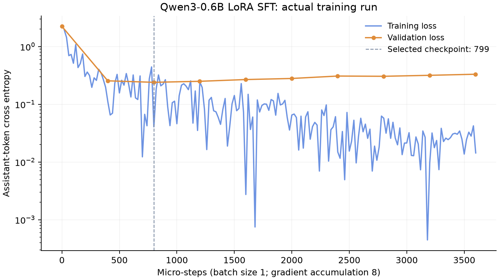
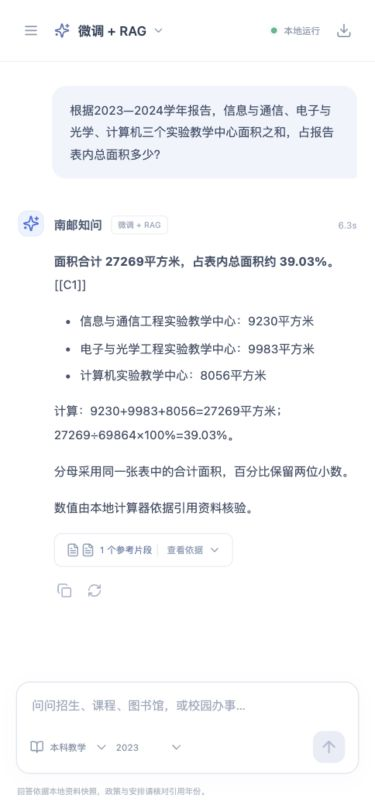

# 南邮知问 NJUPT Campus QA

南京邮电大学官方公开资料的本地问答实验，采用 **Qwen3-0.6B、混合 RAG、独立 MLX LoRA SFT、Ollama、FastAPI 和 React**。提供原模型、RAG、SFT、SFT＋RAG 四种模式，以及可追溯的计算工具。

**首版 SFT 与 RAG 链路均由项目负责人设计**，团队成员在已有方案上承担部署评测、故障定位、数据整理和后续调优，见[协作说明](docs/CONTRIBUTIONS.md)。校园系统独立实现，Harman RAG 仅作设计思路参考。

## 实验结论

2026-10-26 的冻结实验包含 **56 份官方资料、2461 个检索片段、1500 条 SFT 样本和三轮实际 LoRA 训练**。固定 80 道校园题的关键事实规则评分为：

- 原模型：16.25%；LoRA SFT：8.75%。
- 原模型＋RAG：**83.75%**；LoRA＋RAG：61.25%。
- 主对照统一 Q8_0、提示和生成参数，关闭计算器与网页规则拒答。
- 后续学习率、checkpoint、adapter 强度和证据对齐实验未稳定超过独立 RAG，已停止进一步搜索并保留基线。

loss 下降没有转化为校园问答正确率提高。本仓库保留协议、逐题输出和退化案例。自动规则分、引用可定位与逐句语义支持是不同指标；旧版事实组隔离还存在跨网页语义重复局限。



完整记录见[实验索引](experiments/2026-10-26/README.md)，复现条件见[复现指南](docs/REPRODUCING.md)。

## 功能

- 学校概况、本科教学、招生、图书馆服务、学生事务五类主题，支持年份和主题筛选。
- 中文 BM25 与 BGE 向量各召回 20 条，经 RRF 融合、本地 reranker 精排，最多提供 5 组证据。
- SQLite 元数据与 NumPy 向量；引用可回到网页正文或 PDF 物理页码。
- 独立 SFT 模式不检索，界面明确标注；流式聊天、历史会话、停止、再生成、复制和 Markdown 导出。
- 计算工具从实际检索命中的资料取数，保留条件、运算数、公式和出处，模型草稿与程序核验分开保存。

<p align="center">
  
  
</p>

## 快速开始

完整流程在 **Apple Silicon Mac、16GB 内存、Python 3.12** 上验证，训练使用 MLX。预先安装 [uv](https://docs.astral.sh/uv/)、[Ollama](https://ollama.com/download)、Node.js 24 与 pnpm 11.6.0。首次安装和模型下载需要网络，准备后推理使用本机资源。

```bash
git clone https://github.com/sengo0723/njupt-campus-qa.git
cd njupt-campus-qa
uv sync --frozen --extra train
pnpm --dir frontend install --frozen-lockfile
pnpm --dir frontend build

# 下载固定官方模型，将未微调基座转为 Q8_0
bash scripts/prepare_runtime.sh

# 使用冻结清洗正文重建索引
uv run --frozen --extra train python -m njupt_qa.cli index

# 20 步试训、三轮正式训练、验证选点、合并、转换和注册
bash scripts/train_and_deploy.sh

# 启动本项目独立服务
uv run --frozen --extra train python scripts/manage.py start --open
```

访问 <http://127.0.0.1:8765>，项目 Ollama 使用 `11435`，不改动系统已有 `11434`。若同时运行两个项目副本，先停止另一个副本。Ollama 从 `PATH` 查找，也可用 `OLLAMA_BIN` 指定。

网页保留原实验默认 SFT＋RAG，可切换效果更好的独立 RAG。若只先使用原模型与 RAG，可在建索引后跳过训练直接启动，手动选择这两种模式；未准备 SFT 权重时，其模式不可用，健康检查不会报告四模式全部就绪。

```bash
uv run --frozen --extra train python scripts/manage.py stop
```

模型权重、adapter、原始 HTML/PDF、索引、环境和会话数据库不随 Git 分发。[数据说明](data/README.md)列明冻结正文、训练与评测材料的范围。原文文件查看需要按复现指南补取原始文件。

## 评测与检查

历史记录位于 `experiments/2026-10-26/`，新运行写入被忽略的 `results/`，默认命令不会覆盖历史记录。

```bash
uv run --frozen --extra train pytest -q
uv run --frozen --extra train python -m njupt_qa.cli doctor
uv run --frozen --extra train python -m njupt_qa.cli eval --split test
uv run --frozen --extra train python -m njupt_qa.cli retrieval-eval
uv run --frozen --extra train python scripts/evaluate_calculations.py
uv run --frozen --extra train python -m njupt_qa.cli acceptance
uv run --frozen --extra train python scripts/offline_check.py
```

批量 CSV 严格为“问题、答案、参考资料”三列。离线隔离依赖 macOS `sandbox-exec`。Linux CI 检查可移植逻辑、数据和前端构建，不代替 MLX 训练、真实模型推理或断网验收。

## 目录

```text
src/njupt_qa/            采集 检索 问答 计算 评测 FastAPI
frontend/               React TypeScript Vite
scripts/                模型准备 训练 部署 调优 离线检查
config/                 官方来源 固定模型版本 Modelfile 网络策略
data/                   冻结正文 SFT 评测 调优与溯源
experiments/2026-10-26/  历史实验 loss CSV 退化案例
tests/                  逻辑 数据隔离 会话 可选 MLX 检查
docs/                   架构 复现 贡献和公开材料说明
```

## 许可与来源

原创代码使用 [MIT](LICENSE)。vendored llama.cpp 保留上游许可证及版本记录，依赖遵循自身许可。学校原文、摘录及衍生问答中的第三方内容不因代码开源被重新许可，见[数据说明](data/README.md)与[第三方说明](THIRD_PARTY_NOTICES.md)。本项目不代表学校官方服务，政策应核对引用资料的年份与原文。
