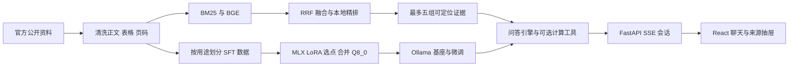

# 系统架构

首版独立 SFT 与 RAG 均由项目负责人设计。FastAPI 按 mode 选择基座或微调模型及检索开关，推理共用本地 Ollama。

文本与元数据保存在 SQLite，向量保存为 NumPy，chunk ID 稳定。年份、正文位置、PDF 页码和来源随证据返回。计算工具仅对实际命中的父文档和表格取数，保留 Decimal 公式和程序核验标注。

SFT 对最终 assistant 回答掩码计算损失。未检索模式只输入提示与会话，不显示虚构来源。年度政策和数字依靠给定证据或 RAG。

每个会话的活动 request_id 与锁控制最终写入，防止停止后旧请求覆盖新结果；悬空 user 轮次在再生成前清理。原文接口限制 raw 目录，HTML 返回转义文本，前端禁用远程 Markdown 图片。服务默认仅监听回环地址。
