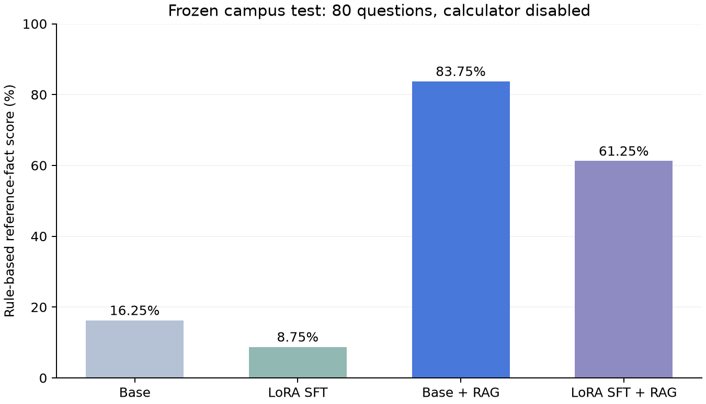

# 实验材料索引

此目录保存程序真实运行的结果，不是课程实验报告。最后核验记录关键模型与原环境校验信息见 [reproducibility.json](reproducibility.json)。本目录为冻结历史记录，新运行写入 results/。

后续 [LoRA 调优记录](tuning/README.md)已按用户要求停止。没有稳定超过独立 RAG 的证据，部署继续使用原基线模型；开发/验证分数与下方原固定测试成绩分别记录。

## 固定测试与消融

固定 80 题包括 75 道公开事实题和 5 道拒答题，五类各 16 题。四组主对照统一模型来源、Q8_0、提示和生成参数，关闭计算器及网页规则拒答。完整配置见 [test/protocol.json](test/protocol.json)。严格关键事实规则评分为：

- 原模型：16.25%，[三列 CSV](test/raw.csv)、[逐题明细](test/raw.jsonl)。
- 原模型＋RAG：83.75%，[三列 CSV](test/rag.csv)、[逐题明细](test/rag.jsonl)。
- LoRA SFT：8.75%，[三列 CSV](test/sft.csv)、[逐题明细](test/sft.jsonl)。
- LoRA SFT＋RAG：61.25%，[三列 CSV](test/sft_rag.csv)、[逐题明细](test/sft_rag.jsonl)。

[汇总与主题统计](test/summary.json)还包括事实、拒答、引用可定位率、参考事实在证据中的覆盖率、平均与 P95 延迟。[稳定知识、时效/政策分组](test/subgroups.json)是事后描述统计。初版所谓“未训练事实”仅按句子事实组 ID 判断；后续[语义隔离审查](tuning/isolation_review.json)发现学校精神与创办年份在其他官方网页中重复出现，不能将全部 75 道正例宣称为未见事实。原始指标保留，调优版单独加强隔离。

此次 SFT 出现负迁移。相对原模型＋RAG，结合微调后有 [21 道退化](sft_rag_regressions.jsonl)、[3 道改善](sft_rag_improvements.jsonl)。这些结果反映本批受控模板和小模型的局限，不能以模板损失下降替代校园问答质量提升。

开发集另存 [dev](dev/)。同一 80 题启用计算工具后的两组结果见 [test_calculator](test_calculator/)；这组主要是直接事实题，两种 RAG 的总体得分均未变化。

## 计算与任务书验收

[四道验收题](acceptance.csv)由实际微调＋RAG＋计算器链路完成，4/4 通过：[完整证据、公式与模型草稿](acceptance.jsonl)、[通过记录](acceptance_summary.json)。结果依次为 65 人、31520 元、外聘教师折算系数 0.5 与生师比 16.38:1、27269 平方米与 39.03%。

另设 [24 道同源计算专项](../../data/eval/calculation_24.jsonl)，由独立列出的官方资料数值与程序运算生成金标准。关闭工具时，两种 RAG 均为 0/24 完整通过；有些回答只算出部分数值，严格评分要求题目所需数值全部正确。启用工具时，两种 RAG 均为 24/24。此对照包含完整表格取证和计算器两部分作用，不归因于微调的算术能力，也不并入主对照正确率。

专项 [协议](../../data/eval/calculation_protocol.json)、[汇总](calculation_24/summary.json)和四种设置的三列 CSV、逐题 JSONL 均在 [calculation_24](calculation_24/)。

## 检索、训练与资源

75 道正例检索比较见 [retrieval_summary.json](retrieval_summary.json)与 [retrieval_details.jsonl](retrieval_details.jsonl)。BM25、向量、混合、混合加精排的 Recall@5 分别为 88.00%、74.67%、92.00%、93.33%；MRR@5 为 0.6629、0.5284、0.7276、0.7898。相关性按 HTML 来源文档或 PDF 文档与页码定义，粒度比精确片段匹配更粗。

正式 MLX 训练 1200 条、三轮、3600 微步，实际耗时 341.87 秒，MLX 峰值内存 3.143 GB，可训练参数 2293760。按验证损失选第 799 步，最低验证损失 0.240224。见 [训练配置与摘要](training_summary.json)、[全部训练/验证指标](training_metrics.jsonl)、[试训练](training_smoke.json)、[正式日志](train_formal.log)。

独立 150 条 SFT 测试样本的 assistant-token NLL 从 2.249077 降到 0.226365，见 [sft_heldout_loss.json](sft_heldout_loss.json)。该测试衡量同类模板的证据作答与格式能力，不等价于独立校园问答测试。

[权重核验](model_verification.json)确认基座转换、全部 56 个适配矩阵更新、合并误差和两份 GGUF。两套部署的模型摘要与结果逐行一致。固定来源模型与 llama.cpp 版本分别保存在 config/model_sources.json 和 scripts/vendor/llama.cpp/SOURCE.json。

[推理内存抽样](inference_memory.json)记录一次实际暖启动 HTTP 请求：后端、项目 Ollama 和推理子进程的 RSS 之和峰值约 4.397 GB。共享页可能重复计数，此值不是唯一物理/统一内存分配量；延迟也包含本机当时负载影响。

## 离线与界面检查

[offline_verification.json](offline_verification.json)记录真实 macOS 进程网络隔离：Ollama 与后端均禁止非回环外联，外网探测被系统拒绝，四种推理模式可执行，四道验收题通过，静态资源与本地 HTML/PDF 均可读取。“模式可执行”不代表未检索模式的事实回答正确。

[pytest.log](pytest.log)为 18 项通过的代码检查。[screenshots](screenshots/)保存桌面、手机和来源抽屉截图。重命名、引用跳转、复制、停止后重新生成与会话无重复均已检查。

评分采用透明关键事实、数字和拒答规则，不是人工盲评。引用可定位和证据包含答案关键词也不代表每句回答都由证据支持。全部逐题输出可供人工复核；本批实验没有以这些代理指标宣称人工级语义正确率。

公开版已移除本机绝对路径，保留原始指标。源码更新后的哈希及材料范围见根目录 PUBLICATION_MANIFEST.json 和 docs/PUBLICATION.md。
